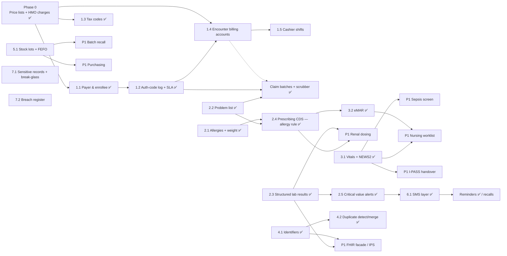

# CareVault implementation roadmap

How to build the features recommended in [`reports/EHR features for CareVault.md`](../reports/EHR%20features%20for%20CareVault.md), in dependency order, mapped onto this codebase.

Every item follows the conventions in `CLAUDE.md`:
- **Tables:** new tables go in `lib/db/schema.ts`, plus a `lib/db/add-<feature>.ts` script with a matching `db:migrate-<feature>` npm script.
- **Queries:** every query is scoped by `organisationId`, soft-deleted rows are filtered out, and state changes call `logAudit()`.
- **Permissions:** checks go through `requirePermission`, using module keys from `APP_MODULES`.
- **Pluggable gateways:** anything that talks to an outside system sits behind an interface with a mock, the way `lib/payments/` does.

Effort: **S** < 2 engineer-weeks, **M** 2–6, **L** > 6.

---

## Phase 0 — HMO price lists & billing ✅ (done)

**What shipped**

| Piece | Where |
|---|---|
| `price_lists`: one tariff schedule per HMO contract, with effective dates and an active flag, rejected if it overlaps another active list for the same HMO | `lib/db/schema.ts`, `lib/billing/priceLists.ts` |
| `price_list_items`: tariff line per lab test or product, with coverage (covered/excluded), co-pay %, and whether the service needs HMO authorization | `lib/db/schema.ts` |
| `hmo_charges`: the HMO's share of every settled item, with amounts snapshotted at settlement and an optional authorization code (`unique(itemType,itemId)`, so it can never be double-billed) | `lib/db/schema.ts` |
| Pricing engine: one function decides self-pay vs HMO tariff vs excluded/not listed, and the patient vs HMO split, in a fixed number of queries | `lib/billing/pricing.ts` (`priceBillItems`, `recordHmoCharges`) |
| Patient payments (card, wallet, bank transfer) charge only the patient's share; the HMO share is recorded when the payment settles | `app/api/payments/*`, `lib/payments/apply.ts` |
| Finance desk shows the split; "Mark as Paid" opens a confirm dialog that captures the authorization code | `app/(authenticated)/finance/*`, `app/api/{requests,prescriptions}/[id]` |
| Price-list screens: create (seeded from self-pay prices or empty), a tariff editor with bulk "% of self-pay", an edit-details dialog, soft delete | `/finance/price-lists`, `/finance/price-lists/[id]`, `app/api/price-lists/*` |
| HMO Billing tab: receivables by HMO and month, bulk mark claimed/paid/rejected (rejected requires a reason), attach auth codes later, CSV export | `finance/components/HmoBillingTab.tsx`, `app/api/hmo-charges` |
| Patient portal shows only the co-pay; fully covered items show as "covered by your HMO" and can't be selected for payment | `app/api/my-history`, `my-history/components/PendingPaymentTab.tsx` |

**Known limits, carried into later phases**
- Prices are still calculated live, as before. The HMO charge is snapshotted at settlement, but the patient's quoted amount isn't frozen until they pay. Phase 1.4 fixes this by recording each charge when it's ordered.
- Pay-with-plan still uses the self-pay price, which only matters for a patient who has both an HMO and a subscription plan.
- Analytics revenue (`app/api/analytics`) still adds up self-pay prices for paid items. Switch it to `payments` plus `hmo_charges` in Phase 1.4.
- Prescriptions without a brand (`productId` null) have no price. That gap already existed.

---

## Dependency map

Phases 1–7 are separate tracks. With two engineers, a sensible split is **Revenue (Phase 1)** in parallel with **Clinical (Phases 2→3)**, then Identity, Stock, SMS and Compliance in whatever order customers ask for.

---

## Phase 1 — Finish the revenue cycle (P0)

### 1.1 Payer master & enrollee record ✅ (done)
- **HMOs are per organisation.**
  - `hmos.organisationId` was added, with name uniqueness per organisation (case-insensitive, non-deleted rows only).
  - The old global list was split by `lib/db/add-org-hmos-and-coverages.ts` (`npm run db:migrate-org-hmos-coverages`). Every organisation got its own copy, and patients, price lists and HMO charges were re-pointed to their organisation's copy.
  - The HMO API (`app/api/hmo/*`) is scoped to the organisation. An HMO can't be deleted while patients are actively enrolled with it.
- **Payer master fields:** payer type, short code, contact person, phone, email, and the claim submission window in days (for the claim checks). They're edited in Setup → HMO.
- **`patient_coverages`:** membership number, plan, principal or dependant (with the principal's name and number), primary provider for capitation, validity window, and status (active/suspended/ended).
  - Only one coverage per patient can be active (`lib/billing/coverage.ts`).
  - Existing HMO patients were backfilled.
  - `patients.hmoId`, `policyNumber` and `insuranceType` are kept as a mirror of the active coverage. Only `syncPatientMirror` writes them.
  - The registration and edit forms go through `applyRegistrationInsurance`: switching HMO ends the old coverage and opens a new one.
- **`eligibility_checks`:** channel, result, HMO reference and notes, plus who checked and when. Coverage is "stale" when there's no "eligible" check within `organisations.eligibilityRecheckDays` (default 30).
- **Pricing:** bills come from the active coverage that's valid *today*. An expired or suspended coverage bills self-pay. `hmo_charges.coverageId` is recorded.
- **UI:**
  - A coverage panel in the patient View modal, for adding/changing HMO, editing, suspending, ending, reactivating and logging eligibility checks.
  - The finance desk flags "Eligibility not verified", and staff can log a check from the confirm-payment dialog.
- **Not done yet:**
  - The patient history page still shows only the mirrored HMO and policy number.
  - New organisations start with an empty HMO list. Add a "copy a starter list" option if onboarding needs it.

### 1.2 Authorization-code log with 60-min SLA ✅ (done)
- **Schema:** `npm run db:migrate-hmo-authorizations` adds two tables and a column.
  - `hmo_authorizations` records patient, coverage, HMO, status (pending/approved/denied/cancelled), source (auto/manual), channel, emergency flag, raised at/by, **sent at/by**, code, valid until, denial reason, responded at/by, escalation (time, note, who), and notes.
  - `hmo_authorization_items` lists the requests and prescriptions an authorization covers.
  - `hmo_charges.authorizationId` links a charge to its authorization.
- **SLA:** the clock starts at `sentAt`, not when the request was raised, so time the hospital took to send it doesn't count against the HMO. "Breached" means the HMO response took more than 60 minutes (`authorizationSla` in `lib/billing/authorizations.ts`).
- **Raised automatically** (`raiseAuthorizationsForOrders`) when a lab/radiology request or prescription is created for a covered item that the tariff marks `requiresAuthorization`.
  - It creates an unsent pending request.
  - Further orders for the same coverage within 2 hours join the same unsent request.
  - An item gets no new request if it already has a pending or approved one. A denied item can be re-raised.
  - A failure here never blocks the clinical order.
- **Settling** goes through `lib/billing/settle.ts#settleHmoItems`:
  - The item's approved authorization is attached to the HMO charge automatically.
  - A code typed at the desk is written to the log: it approves the pending request, or logs an already-approved one.
  - Approving an authorization later also links any charges already settled ("treat now, attach later").
- **Declined = self-pay:** if an item's latest non-cancelled authorization is declined, `priceBillItems` prices it with the new basis `auth_declined`. The patient pays the self-pay price and no HMO charge is recorded. Re-request it from the Authorizations tab ("declined before"), or enter a new code at the desk; either logs an approval and bills the HMO at its tariff again.
- **UI:**
  - **Finance → Authorizations tab.** Counts for not sent, waiting and over 60 minutes, plus average HMO response time. Each row shows a live timer and a tap-to-call HMO phone number. Actions: mark sent (channel), record code (with valid-until), declined (reason), escalate to NHIA (note, highlighted once over 60 minutes), cancel, and edit an approved code. Staff can also log a new request (patient search, then pick covered unpaid services) and export the full log as CSV evidence.
  - **Finance tables and confirm dialog.** These show the authorization state (approved code, awaiting HMO for N minutes, not sent, declined) and warn when a code has expired.
- **Not done yet:**
  - "Attach code later" in the HMO Billing tab still edits only the charge's text code, not the authorization log. Point it at the Authorizations tab.
  - There are no in-app or SMS notifications when a request is raised or breached. That needs the 6.1 messaging layer and a more general `notifications` table.

### 1.3 Tax codes on catalog items ✅ (code done; migration `db:migrate-claims-tax`)
- **Schema:** `lab_tests.taxCode` and `products.taxCode`, one of `zero_rated` (default) | `standard` (7.5%) | `exempt`. `lib/billing/tax.ts` holds the definitions.
- **Prices:** catalog prices are VAT-inclusive. `priceBillItems` returns `taxCode` and `vatAmount`, the VAT contained in the charged price.
- **UI:** the VAT treatment is chosen in the Setup test and product forms.
- **Next:** per-invoice VAT lines arrive with 1.4 billing accounts; NRS e-invoicing (P2) builds on these fields.

### Monthly HMO claim batches ✅ (P1 pulled forward; migration `db:migrate-claims-tax`)
- **Schema:**
  - `claim_batches`: HMO, service month, reference (e.g. `CLM-LWH-202610-01`), status (draft/submitted/closed/cancelled), submission channel and time, HMO acknowledgement number, and a snapshot of the total claimed.
  - `hmo_charges` gains `claimBatchId`, `paidAmount`, `paidAt` and a `queried` status. Each charge is a claim line.
- **Pre-submission checks** (`lib/billing/claims.ts#scrubCharges`):
  - **Errors:** missing authorization code where the HMO requires one; authorization expired before the service date; no membership number.
  - **Warnings:** no ICD-11 diagnosis on the consultation; past the HMO's submission window (`hmos.claimSubmissionDays`); eligibility not verified around the service date; lines that look like duplicates.
- **Flow (Finance → Claims tab):**
  1. "New claim" (HMO + month) creates a draft containing every unclaimed charge for that HMO and month.
  2. Review the checks, remove lines, and add charges that arrived later.
  3. Export a CSV (with ICD-11 diagnoses) or print the claim form.
  4. Submit. Submission is refused while any line has an error, unless staff confirm. Lines then become `claimed`.
  5. Post the HMO's response line by line: paid in full, part-paid (short payment), queried, rejected (reason required), or query answered.
  6. The batch closes automatically once every line is paid or rejected.
- **Ageing:** an outstanding-by-HMO table with 0–30 / 31–60 / 61–90 / 90+ day buckets, counted from the submission date.
- **HMO Billing tab:** its bulk status buttons now only change charges that aren't in a claim.
- **Not done yet:**
  - Per-HMO export templates (collect the real formats from a pilot hospital).
  - Attaching documents to answer a query.
  - A statement of disagreement for disputed short payments.

### 1.4 Admission billing accounts ✅ (inpatient slice — migration `db:migrate-admission-billing`)
Built as a lighter version of the original design. There's no separate `billing_accounts` table: an admission *is* the account. Its bill is assembled from three sources. Outpatient visits keep the existing per-item flow.
- **Schema:**
  - `wards.dailyRate` (null means no bed charge).
  - `service_items`: a non-lab, non-drug catalog with name, category, price and tax code.
  - `patient_charges` for bed days and services. Each row has a quantity, a frozen unit price, `paymentStatus` (not_paid/paid/waived) with who/why for waivers, and a void reason.
  - A unique index on (admission, chargeDate) for bed days. Voided days are included, so a removed day is never regenerated.
  - `admissions.dischargeBalance` / `dischargeBalanceNote`.
- **Bed days** (`lib/billing/admissionBill.ts`):
  - Charged per WAT calendar day, using the ward the patient was in at the end of that day (transfers are respected).
  - The discharge day counts only if discharge is at or after 12:00, or on the admission day itself.
  - Days are synced lazily whenever the bill is opened and at discharge, so no cron job is needed. Days after discharge are trimmed.
- **Bill** (`GET /api/admissions/[id]/bill`): bed days, services, and lab/radiology requests and prescriptions that are linked to the admission or fall inside the stay window.
  - All lines are priced by `priceBillItems`, which gains the `"charge"` type and the `service` and `ward_bed` price-list item types, so HMO tariffs, co-pays and authorizations apply.
  - Totals: gross, HMO share, patient share, paid, waived, outstanding.
- **Actions:**
  - Add a service, which raises an authorization if the tariff requires one.
  - Mark a line paid (cash/transfer/POS, same as the finance flow).
  - Waive or remove a charge, with a reason and an audit log entry.
  - Settle the whole balance from the patient's wallet (`bill/pay-wallet`), which sends a receipt SMS.
  - Print a consolidated bill.
- **Discharge:** the discharge modal shows the outstanding balance. Discharging with a balance needs a written note, stored on the admission and audit-logged. Otherwise the API returns 409.
- **UI:**
  - A Bill section in the admission drawer.
  - A Finance → "Inpatient bills" tab listing current admissions and discharged patients who still owe.
  - Setup → Services.
  - A daily rate field on the ward form.
  - Services and bed rates in the price-list editor.
- **Not done (later):** outpatient visit accounts, charge capture at order time with a held queue, `payment_items.chargeId` back-links for requests/prescriptions, admission deposits, and switching analytics to the ledger.

### 1.5 Cashier shifts & end-of-day reconciliation ✅ (migration `db:migrate-cashier-shifts`)
- **Schema:**
  - `cashier_shifts`: cashier, status (open/closed/pending_review/reviewed), opened at, opening float, closed at, expected and counted amounts for cash/POS/transfer, variance, the cashier's note, and the supervisor sign-off (who, when, note).
  - A partial unique index allows one open shift per cashier.
  - `payments` gains `shiftId`, `channel` (cash/pos/transfer) and `posReference`, plus a new method `"desk"`.
- **Desk payments** (`lib/billing/shifts.ts`):
  - "Mark paid" on requests, prescriptions and admission charges needs a channel and an open shift whenever the patient pays more than ₦0.
  - It then creates a real `payments` row with its `payment_items`, in the same transaction as the paid flag and HMO settlement.
  - `settleHmoItems` now returns the final pricing, so a re-authorized item records the co-pay rather than the self-pay amount.
  - Items billed fully to the HMO need no shift.
- **Close (cash-up):**
  - Expected cash is the opening float plus cash taken. Expected POS and transfer are the totals taken.
  - If every channel matches, the shift is "closed". Otherwise a note is required and the status becomes "pending_review".
  - A finance supervisor can also close a shift a cashier forgot.
- **Sign-off:**
  - Requires finance *edit*. Taking payments needs finance *add* or *edit*.
  - Nobody can sign off their own shift.
  - Opening, closing and sign-off are all audit-logged.
- **UI:**
  - A "My shift" strip on Finance: open with float, running takings by channel, close.
  - A channel picker and POS reference in the settle modal, which can also open a shift inline.
  - A Finance → Shifts tab with date and status filters, totals, a shift detail view listing every payment, a sign-off box and a printable cash-up sheet.
- **Later:** transfer receipt uploads (`payment_proofs`), refunds and reversals against a shift, and blind counts (hiding the expected amount until the count is entered).

---

## Phase 2 — Clinical safety foundation (P0)

### 2.1 Structured allergies & weight ✅ (migration `db:migrate-allergies-problems`)
- **Allergy status:** `patients.allergyStatus` is `not_assessed` (default) | `nkda` | `has_allergies`. It follows the allergy list via `lib/clinical/summary.ts#syncAllergyStatus`.
- **`patient_allergies`:**
  - Category: drug (a generic, or free text), drug class, food, environment or other.
  - Allergy vs intolerance, reaction, severity, how certain (unconfirmed / confirmed / refuted), and onset.
  - Records are never hard-deleted: "refuted" means it was tested and ruled out; soft delete means it was entered in error.
- **`drug_classes`:**
  - 16 built-in families (seeded with a null organisation by the migration): penicillins, cephalosporins, sulfonamides incl. SP, NSAIDs, artemisinins, quinolines, aromatic anticonvulsants, ACE inhibitors, contrast and others. They're defined in `lib/cds/drugClassSeed.ts`.
  - Hospital-specific families can be added in Setup → Drug Families.
  - Members are ingredient names matched as whole words against `drug_generics.name`, with cross-reactivity between some families (penicillins ↔ cephalosporins and carbapenems).
- **`patient_measurements`:** weight and height with date and source (measured or reported by the patient). BMI is calculated.
- **UI:**
  - `components/clinical/ClinicalBanner` (red / green / amber allergy strip, conditions, weight) and `ClinicalRecordPanel` (full management).
  - Used in the patient View modal, the patient history page, and the consultation screen (banner with an "Update" toggle), plus the banner in the prescription form.
  - The patient portal shows a read-only "My allergies & conditions" card.

### 2.2 Problem list ✅
- **`patient_problems`:** ICD-11 code (validated) or free text, status (active / inactive / resolved), onset and resolution dates, notes, and the source visit. Soft delete means entered in error. A condition can't be added twice while it's still open.
- **From consultations:** tick "Ongoing" next to a diagnosis and saving the visit adds it to the problem list (`app/api/visits`).
- **Not done yet:** an ICD-10 crosswalk for HMO claims.

### 2.4 (first rule) Drug-allergy alert ✅
- **Checks** (`lib/cds/allergy.ts#checkPrescriptionAllergies`):
  - **Critical:** a direct ingredient match, or a class match (the allergy is to a family, or to a drug in the same family as the new one).
  - **Warning:** cross-reactivity between families, or allergy status never recorded.
- **Enforced on the server in `POST /api/prescriptions`:** every alert needs a coded override reason (`OVERRIDE_REASONS`, with "other" requiring a note), otherwise the server returns 409 with the alerts. Overrides are logged to `cds_alert_events` and the audit log.
  - "Asked the patient — no known allergies" also records NKDA on the patient's file.
- **Live preview:** the prescription form calls `POST /api/cds/prescription-check` as each drug is picked and shows a review panel before submitting.
- **Still to do for 2.4:** duplicate therapy, dose range, paediatric mg/kg (weight is now captured), pregnancy, interactions, a pharmacy re-check at dispensing, per-org rule tuning, and the override-rate dashboard.

### 2.3 Structured lab results ✅ (migration `db:migrate-lab-results`)
- **`lab_test_parameters`:** the result fields per test. Type: numeric / choice / text. Each field has a unit, a LOINC code, default normal low/high plus optional sex- and age-specific ranges, critical low/high, and decimals. Fields that are removed are soft-deleted, so past results keep them.
- **`lab_result_values`:** one value per field per request. The unit, the reference range that applied and the flag are snapshotted at entry. A correction updates the row and sets `amendedAt`; the audit log keeps the old value.
- **Templates** (`lib/lab/templates.ts`): FBC, malaria parasite, FBS/RBS, E/U/Cr, calcium, LFT, lipid profile, urinalysis, genotype, blood group, HBsAg, HCV and urine hCG. They're loaded from Setup → Tests → Result fields, which suggests a template from the test's name. The ranges are typical adult values that the hospital's laboratory director must confirm.
- **Lab workflow:** for tests with fields, the lab worklist shows "Enter results"/"Edit results", with live High/Low/Critical flags as values are typed. File upload is still available ("Attach file").
- **Viewing:** results show as a table in the lab's View modal, the patient history page and the patient portal.
- **Not done yet:** a verification step (enter → senior verifies), delta checks against previous results, trend charts, and analyzer interfaces (P2).

### 2.5 Critical lab value alerts ✅
- **Raising and acknowledging:** `critical_alerts` are raised when a value goes past a critical limit and are addressed to the ordering clinician. The acknowledgement records the clinician's action note, and any clinician may acknowledge.
- **Corrections:** correcting a value to a different critical value re-opens the alert. Correcting it out of the critical range closes the alert automatically.
- **Doctor side:**
  - A red bar at the top of every staff page, polled every minute, until the doctor acknowledges.
  - The notification bell entry says "CRITICAL RESULT …".
- **Lab side:**
  - A "Critical results awaiting doctor acknowledgement" panel on the Laboratory and Radiology pages.
  - Alerts unacknowledged after 30 minutes (`CRITICAL_ESCALATION_MINUTES`) are flagged overdue, and the lab records its phone follow-up.
- **Patient portal:** values for a request with an unacknowledged critical result are withheld ("Being reviewed by your doctor") until the doctor acknowledges.
- **Not done yet:** automatic escalation to a second person, and SMS (needs 6.1).

---

## Phase 3 — Inpatient care (P0)

### 3.1 Vitals flowsheet + early-warning scores ✅ (migration `db:migrate-vitals`)
- **`vital_signs`:** temperature, pulse, respiratory rate, systolic/diastolic BP, SpO₂, on oxygen (plus flow), SpO₂ scale 2, ACVPU, pain, glucose. Each set stores its score type, score, band, triggers, next-due time, and who was informed. It's linked to the current admission. Soft delete means entered in error.
- **Scores** (`lib/clinical/ews.ts`, pure functions, calculated on the server at save time):
  - **NEWS2:** the exact RCP 2017 chart, including SpO₂ scale 2 and the "3 in a single parameter" low–medium band. Monitoring frequency follows the RCP minimums: 12 h / 4–6 h / 1 h / continuous (15 min). Checked against worked examples.
  - **MEOWS:** red/yellow triggers from a common UK chart (one red, or two yellows, means escalate). The maternity lead must confirm the thresholds.
  - **Paediatric:** an *interim* score on APLS age-specific normal ranges. It is clearly labelled as not a validated PEWS; replace it with the hospital's chosen PEWS chart when one is adopted.
  - **Which score applies:** under 16 → paediatric; pregnancy or postpartum on the problem list (ICD-11 JA/JB codes, or text) → MEOWS; otherwise NEWS2. Staff can override it on the form.
- **UI:**
  - `components/clinical/ObservationsPanel`: the entry form colours each box by its points as values are typed and shows the live score and required action. When escalation is needed it asks "Who did you inform?". A colour-coded chart shows the last 8 sets.
  - Used in the admission details drawer (with the allergy/conditions banner) and on the patient history page.
  - The admissions list has an "Obs / score" column showing the latest score, next due time, or "Obs overdue".
- **Not done yet:**
  - A ward board view.
  - Automatic paging of the doctor on a high score (needs 6.1 SMS and a notifications table that isn't tied to lab requests).
  - The sepsis screen (P1: NEWS2 ≥ 5 plus suspected infection).
  - Fluid balance chart.

### 3.2 eMAR ✅ (migration `db:migrate-emar`)
- **Prescriptions:** new columns `doseAmount`, `route`, `frequency` (`lib/emar/schedule.ts` FREQUENCIES: OD / BD / TDS / QDS / Q4–12H / NOCTE / WEEKLY / STAT / PRN), `durationDays`, `startAt`, PRN rules (indication, max per 24 h, minimum interval), `admissionId`, and stop (`stoppedAt` / by / reason).
  - Prescribing from the admission's medication chart passes `admissionId`, and the dose, route and frequency are then required.
  - Outpatient prescribing is unchanged.
- **The schedule is calculated, not stored:** `scheduledSlots()` maps each frequency to ward round times (WAT). The first dose is the first round time at or after the start (with 30 minutes' grace). The course ends at the stop time or at start + duration.
- **`medication_administrations`:** given / held / refused / not available / missed, one row per scheduled slot (unique index) or per PRN/STAT dose. Records the dose, time given, reason, PRN indication and effect, who gave it, and the witness. Soft delete ("undo") requires a reason, which goes in the audit log.
- **Safety checks** (`lib/emar/record.ts`):
  - The time must be a real scheduled slot that hasn't already been recorded.
  - Anything other than "given" needs a reason.
  - PRN doses respect the 24-hour maximum and minimum interval.
  - A stopped drug can't be given.
  - **High-alert medicines** (`lib/emar/highAlert.ts`: insulins, concentrated electrolytes, anticoagulants, opioids, oxytocin, sedatives/paralytics, vasoactives, chemotherapy) need a second, different staff member recorded as witness.
  - The "give" dialog includes a five-rights confirmation tick box.
- **UI:**
  - `components/clinical/MedicationChartPanel` in the admission details: day navigation; each drug shows its slots as coloured chips (upcoming / due / overdue / given / held / refused / not available / missed), plus PRN "Give" with limits, "Record effect", Stop, and Prescribe.
  - The admissions list "Meds" column shows doses overdue and due now (`/api/emar/ward`).
  - A dose counts as overdue 60 minutes after its time (`OVERDUE_AFTER_MINUTES`).
- **Not done yet:**
  - Barcode / QR scanning at the bedside (P2).
  - IV infusion rate charting.
  - Dose changes as a new version (for now, stop and re-prescribe).
  - Per-ward round times.
  - A pharmacy allergy re-check at dispensing (dispensing screen not touched).
  - The witness is chosen from a list rather than re-authenticating, because login friction was removed on purpose. Revisit if auditors require it.

---

## Phase 4 — Identity & interoperability base (P0)

### 4.1 Patient identifiers ✅ (partial — migration `db:migrate-patient-mpi`)
- **`patient_identifiers`:** previous hospital number / legacy MRN, birth certificate, passport, NHIA, insurance, voter's card, driver's licence and other.
  - Searchable from the patients list and used by the registration match.
  - A number already on another active patient is refused as a likely duplicate.
  - Managed in the patient View modal ("Other identifiers").
  - `patients.nin` / `mrn` stay the primary identifiers.
- **Not done yet:**
  - Coded state/LGA/ward address (patients have no address fields yet; needs the Nigeria Core code lists).
  - `dhis2OrgUnitUid` on organisations.
  - NIN verification (P1).

### 4.2 Duplicate detection & merge ✅
- **Matching** (`lib/mpi/match.ts`, pure functions):
  - Signals: NIN (same → 100, different → strong negative), phone (last 10 digits), DOB (same / day-month swapped / same year), names, sex.
  - Names use Jaro–Winkler similarity plus a sound-alike key that unifies spellings such as Mohammed / Muhammad.
  - Bonuses for full name plus DOB and for swapped first/last names. A penalty for a matching surname with a clearly different first name catches siblings and twins.
  - Calibrated on test cases: likely ≥ 70, possible 50–69.
- **Candidates** (`lib/mpi/candidates.ts`):
  - Registration (`POST /api/patients`) replaces exact phone or name+DOB matching with an SQL pre-filter (trigram similarity, `pg_trgm` GIN indexes) and scoring. The warning shows the score, the reasons and a link to the existing record.
  - `/patients/duplicates` lists scored pairs; pairs marked "Different people" are skipped.
- **Merge** (`lib/mpi/merge.ts`):
  - One transaction.
  - It re-points **every table with a `patient_id`**, found from `information_schema`, so new modules are covered automatically. The moved row ids are recorded.
  - The wallet balance is moved through ledger entries.
  - The survivor's blank demographics are filled from the merged record.
  - The merged MRN is kept as a `legacy_mrn` identifier.
  - Only one HMO coverage stays active; the mirror and allergy status are re-synced.
  - The merged record is soft-deleted with `mergedIntoId`. Its URLs return 410 and show a "merged into" link.
  - Refused if the two records have different NINs.
  - **Undo** moves exactly the recorded rows back, reverses the wallet move and restores the filled fields.
  - Restricted to staff with delete permission on Patients. A reason is required, and everything is audit-logged.
- **Not done yet:**
  - A scheduled background scan (the page currently computes pairs on demand; it's fine at the current size).
  - Restoring ended coverage on undo.
  - Merging across organisations (intentionally not supported).

---

## Phase 5 — Stock safety (P0)

### 5.1 Stock lots + FEFO · M
- **Schema:**
  - `stock_lots`: product, batch number, expiry, supplier, unit cost, quantity received, quantity on hand, received at, status (available/quarantined/written off).
  - The product's cases and loose units become a sum over its lots. Backfill one "legacy" lot per product.
- **Dispense:**
  - `DispenseModal` suggests the lot that expires first (first-expiry-first-out). The pharmacist can pick another lot, but must give a reason.
  - Dispensing decrements that lot. `prescriptions.batchNumber` gets replaced by a `lotId` link, keeping the text column for history.
- **Alerts:** a nightly job raises expiry alerts at 90, 60 and 30 days. Write-offs need approval and are logged.

---

## Phase 6 — Patient messaging (P0)

### 6.1 SMS notification layer ✅ (migration `db:migrate-messaging`)
- **Gateway** (`lib/messaging/`, same pattern as payments):
  - `MessagingGateway` interface. The default is `mock`: nothing is sent, messages are only logged.
  - `termii.ts` goes live with `SMS_GATEWAY=termii` + `TERMII_API_KEY`, plus optional `TERMII_BASE_URL`, `TERMII_CHANNEL` (`dnd` reaches numbers on the Do-Not-Disturb register, once Termii approves) and `TERMII_SENDER_ID`.
- **Per-hospital settings** (Setup → Messaging):
  - `organisations.smsEnabled` is **off by default**, so connecting a provider never starts texting patients by surprise.
  - Each hospital sets its own sender ID, chooses which automatic messages go out, and can edit the wording (`message_templates`), with a live preview and SMS length/segment count.
  - It also has a test send and a message log.
- **Patients:** `patients.messagingOptOut` can be set by staff from the patient View, or by the patient through `PUT /api/patients/[id]/messaging`.
  - Care-related messages go to every patient unless they opt out. There's no separate consent record, because most existing patients have none; the opt-out is recorded on their file instead.
  - Staff can send one-off messages from the patient View.
- **Automatic messages** (`lib/messaging/send.ts#sendToPatient`, which never throws):
  - **Booking confirmation:** sent from `POST /api/appointments`.
  - **Day-before and 2-hour reminders:** `lib/messaging/reminders.ts`, run by `POST /api/cron/messages/process` (CRON_SECRET; schedule every 15 minutes) or `npm run cron:messages`.
  - **Results ready:** sent on a file upload or when values are entered, but held back while a critical value is unacknowledged.
  - **Payment receipts:** for gateway, bank-transfer and wallet payments.
  - Each message goes at most once (`outbound_messages.dedupeKey`). Every attempt is logged as sent, failed or skipped, with the reason.
  - The default wording is plain GSM text and each fits in one SMS.
- **Not done yet:**
  - WhatsApp (add a gateway behind the same interface).
  - Delivery reports by webhook from Termii.
  - Replies (STOP or confirm/cancel).
  - Antenatal and immunisation recalls.
  - Cost tracking, and SMS for critical results to doctors.

---

## Phase 7 — Compliance (P0)

### 7.1 Sensitive records & break-the-glass · M
- **Schema:**
  - A `sensitivity` field on problems, visit notes and requests (`normal` | `restricted`).
  - `restricted_categories`: per org (HIV, mental health, reproductive, VIP/staff patient).
  - `access_grants`: user, patient, reason, granted at, expires at, reviewed by and when.
- **Permissions:** add an `APP_MODULES` entry `restricted-records` (view) for the care team. Everyone else sees "Restricted, break the glass?".
- **Break-glass:** the user gives a reason and gets 4 hours of access. It's audit-logged at high severity and goes into a privacy-officer review queue.
- **Hide from portal and proxies:** filter restricted records out of `my-history`, and out of proxy access once that exists.
- **Enforcement point:** one helper, `canSeeRestricted(ctx, patientId)`, called by the history endpoints. Don't scatter the check across routes.

### 7.2 Breach-incident register · S
- **Schema:** `breach_incidents` holds discovered at, description, data categories, approximate number of people affected, containment steps, whether NDPC was notified and when, whether data subjects were notified and when, and status.
- **UI:**
  - A countdown to the 72-hour NDPC deadline from discovery.
  - Notification template fields.
  - An entry in the same admin area as `data-requests`.

---

## P1 / P2 backlog: where each item plugs in

| Feature | Tier | Builds on | Notes |
|---|---|---|---|
| Monthly HMO claim batches, pre-submission checks, query/denial queue, ageing | P1 · L | `hmo_charges`, 1.2, 2.2 | `claim_batches` + `claim_lines` (from `hmo_charges`). The CSV export in the HMO Billing tab becomes a per-HMO export template. Checks: missing or expired auth code, missing diagnosis, past the submission window, duplicate lines. Ageing buckets come from `serviceDate`. |
| Plan benefits/exclusions + patient acknowledgement | P1 · M | Phase 0 `coverage: excluded` | Add per-plan rules to 1.1 coverages, and a signed out-of-pocket acknowledgement before an excluded service. |
| Admission deposits, packages (ANC, delivery, CS), discounts/waivers/refunds with approval | P1 · M | 1.4, wallet | A package is a charge that absorbs its component charges up to a cap. Waivers and refunds go through an approval and `logAudit`. |
| Paystack Dedicated Virtual Accounts | P1 · S | `lib/payments/paystack.ts`, wallet | One account number per patient. The existing webhook credits the wallet. |
| Corporate/retainer accounts | P1 · M | 1.1 (payerType `corporate`), price lists | Price lists already support the corporate payer type. Add credit limits and monthly statements. |
| Capitation ledger & HMO profitability | P2 · M | 1.1, 1.4 | Monthly capitation received vs the cost of services given to capitated enrollees. |
| E-invoice IRN/QR | P2 · M | 1.3, 1.4 | Add an invoice table with the IRN from the access point provider. |
| Claims connector (Curacel / Nigeria Core FHIR Claim) | P2 · L | claim batches, FHIR facade | Behind a `ClaimsGateway` interface. |
| Severe interaction table, renal dosing, pregnancy and high-alert checks | P1 | 2.3, 2.4 | These are new rules in `lib/cds/`. |
| Order sets (malaria, pre-eclampsia, sepsis, DKA, sickle-cell crisis, neonatal sepsis) | P1 · M | 2.4 | Versioned `order_sets` with the guideline source. Applying one creates requests and prescriptions together. |
| Sepsis screen (NEWS2 ≥ 5 + suspected infection) | P1 · S | 3.1, order sets | |
| CDS override-rate dashboard | P1 · S | `cds_alert_events` | |
| Structured notes, sign/cosign, lock-after-sign + addenda | P1 · M | `visits` | Replaces free-text `visits.doctorNotes`. Also covers the compliance item "e-signatures". |
| Discharge summary (auto-filled, PDF) | P1 · M | 2.2, 3.2, notes | Also feeds the portal and IPS export. |
| I-PASS handover, nursing worklist, intake/output chart | P1 · M/S | 3.1, 3.2 | |
| SATS triage + ED board | P1 · M | appointments/visits | Board refreshes by polling, to suit low bandwidth. |
| Maternity (ANC, WHO Labour Care Guide, delivery/newborn) | P1 · L | 3.1, 2.2 | A big module. Scope it with a customer. |
| Theatre + WHO Surgical Safety Checklist | P1 · L | admissions, 1.4 | |
| Immunization tracking + WHO growth charts | P1 · M | 5.1 (vaccine lots), 6.1 (recalls) | |
| Referral / transfer letters | P1 · S | notes | |
| LOINC/UCUM on lab tests, ATC on products | P1 · S–M | 2.3 | |
| FHIR R4 facade per Nigeria Core + IPS export | P1 · L | 4.1, 2.x, 2.3 | Extend the existing `lib/fhir.ts` and `app/api/patients/[id]/fhir`. Serve at `/api/fhir/r4/*` using OAuth2 client credentials. |
| NHMIS monthly summary + DHIS2 push | P1 · L | 2.2, 3.x, 4.1 (`dhis2OrgUnitUid`) | Mapping table from CareVault counts to DHIS2 data elements. |
| IDSR notifiable-disease flags | P1 · M | 2.2 (ICD-11) | |
| NIN verification adapter | P1 · M | 4.1, consent | `IdentityGateway` interface with a mock. Store only `verifiedAt` and the method used. |
| Lab analyzer bridge / PACS | P2 · L | 2.3 | An on-site service outside Next.js. |
| Batch recall | P1 · S | 5.1 | |
| Purchasing (supplier → PO → GRN → invoice) | P1 · L | 5.1, `supply_orders` | |
| Multi-store, transfers, stock-take | P1 · M | 5.1 | |
| Controlled-drug register | P1 · M | 5.1 | Keep a printable copy, since it's unconfirmed whether an electronic register is legally accepted. |
| Bed board + housekeeping | P1 · M | ADT (`beds.status`) | Add dirty, cleaning, blocked and reserved bed states. |
| Slot templates, rosters, queue tokens + display | P1 · M | appointments | |
| Multi-branch tenants | P2 · L | everything | Adds a `branchId` beside `organisationId`. Retrofitting gets harder as more of the above lands, so decide early. |
| Assets, diet orders, visitor passes (from the admission badge) | P2 · S–M | ADT | |
| Mortuary, blood bank | P2 · M/L | — | |
| Portal bill view + instalments | P1 · M | 1.4, wallet | |
| Family/proxy access | P1 · M | 7.1 | Proxies must not see restricted records. |
| Self-booking + deposit + waitlist | P1 · M | appointments, payments, 6.1 | |
| Secure messaging, refills, PROMs | P1 · M | 6.1 | |
| Management KPI dashboard + scheduled reports | P1 · M/S | 1.4, 3.x, 2.3 | Nightly per-org summary tables. Report downloads are audit-logged. |
| GAID compliance pack, access reviews, audit anomaly rules, amendment requests, retention policies | P1 | `audit_logs`, `data_requests` | |
| Encryption at rest, field-level encryption, restore tests | P1 · M | infra | |
| AI drafting (discharge/handoff), "explain my result" | P2 · M | notes, 2.3 | Log the model and version, plus the clinician's accept/edit/reject. Needs a DPIA (data protection impact assessment). |
| MFA as an **opt-in, per-tenant** setting only | — | auth | Off by default. The product owner removed 2FA on purpose. |

---

## Suggested order for the next three releases

1. **Release A (revenue):** 1.1 Payer/enrollee → 1.2 Auth log → 1.3 Tax codes, then claim batches on top of `hmo_charges`. Claim batches only need these three, not 1.4, if they work from `hmo_charges` lines. That ships monthly claims fastest.
2. **Release B (safety):** 2.1 Allergies → 2.2 Problems → 2.4 CDS v1 (allergy + duplicate + paediatric weight). In parallel: 2.3 Structured results → 2.5 Critical alerts.
3. **Release C (inpatient + ledger):** 3.1 Vitals/NEWS2, 1.4 Billing accounts with bed-days, 1.5 Cashier shifts, then 3.2 eMAR.

Phases 4–7 are smaller and can each be slotted in as a single sprint.

## Open questions to settle with a pilot hospital
- The real per-HMO claim formats and submission windows. Collect two or three HMO templates before building claim exports.
- Whether HMOs in the pilot pay by capitation, fee-for-service, or both. This decides the order of the capitation ledger and 1.4.
- Who maintains the severe-interaction table. It needs a named pharmacist owner before 2.4 ships.
- Whether to add multi-branch support now (a schema decision) or wait until a hospital group signs.
